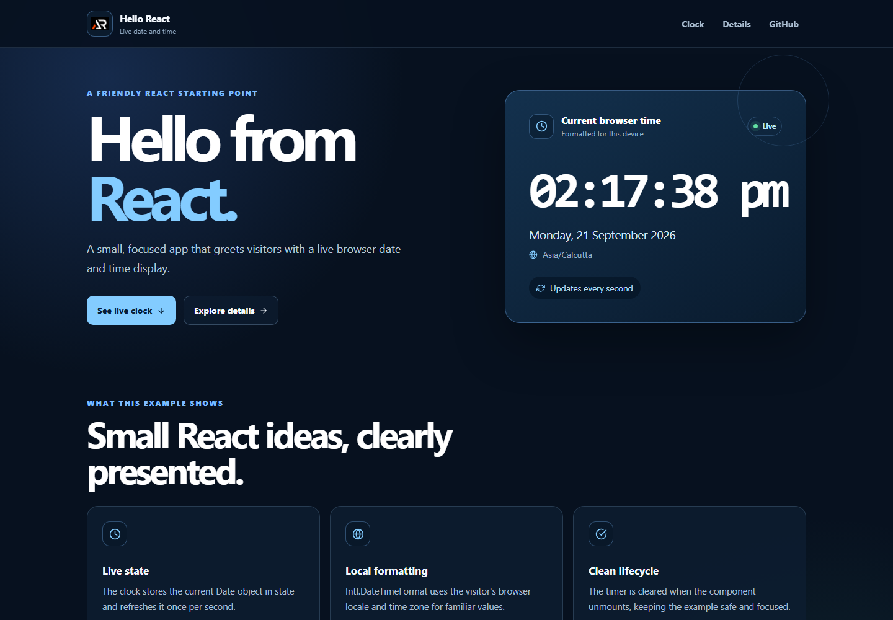

# Basic React Hello App



A small React starter app that combines a friendly greeting with a live browser date and time display. It is designed to demonstrate state, effects, browser locale formatting, responsive layout, and accessible interface basics.

## Features

- Live local time, date, and browser time zone
- One-second updates with timer cleanup
- Responsive desktop and mobile layout
- Fixed header with a small-screen menu
- Keyboard-friendly controls and visible focus states
- Icon-only social and support links in the footer
- Floating back-to-top control

## Tech stack

- React 18
- Create React App
- JavaScript
- Plain CSS
- React Icons

## Run locally

```powershell
npm install
npm start
```

Open `http://localhost:3000` in a browser.

## Production build and deployment

```powershell
npm run build
npm run deploy
```

Live app: [https://a2rp.github.io/basic-reactjs-hello-app/](https://a2rp.github.io/basic-reactjs-hello-app/)

## Future prospects

The app can be extended with multiple time zones, selectable date formats, theme preferences, and optional reminders while keeping the same simple foundation.

## Images

- `screenshot.png`: current home-screen preview used in this README
- `public/preview.png`: local social sharing image
- `public/logo.png`: brand mark used in the header

## License

This project is available under the MIT License. See [LICENSE](LICENSE).

## Links

- Portfolio: [https://www.ashishranjan.net/](https://www.ashishranjan.net/)
- GitHub: [https://github.com/a2rp](https://github.com/a2rp)
- CodePen: [https://codepen.io/ash1198](https://codepen.io/ash1198)
- LinkedIn: [https://www.linkedin.com/in/aashishranjan](https://www.linkedin.com/in/aashishranjan)
- Facebook: [https://www.facebook.com/theash.ashish/](https://www.facebook.com/theash.ashish/)
- YouTube: [https://www.youtube.com/@ashishranjan-ashz?sub_confirmation=1](https://www.youtube.com/@ashishranjan-ashz?sub_confirmation=1)
- Email: [mailto:ash.ranjan09@gmail.com](mailto:ash.ranjan09@gmail.com)

## Support

- Support: [https://a2rp-donation-page.netlify.app/](https://a2rp-donation-page.netlify.app/)
- Buy Me a Coffee: [https://buymeacoffee.com/a2rp](https://buymeacoffee.com/a2rp)
- Patreon: [https://www.patreon.com/a2rp](https://www.patreon.com/a2rp)
